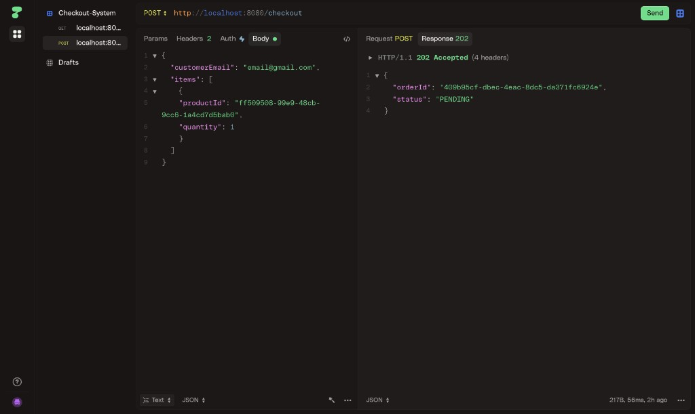

# Checkout System

> **Português (BR):** [README.pt-BR.md](README.pt-BR.md)

HTTP checkout API that accepts orders quickly (`202`) and processes payment and stock in a separate **Worker** behind RabbitMQ. PostgreSQL is the source of truth; Redis handles idempotency on `POST /checkout`.

No frontend by design — validate with Insomnia/curl, DBeaver, and k6.

**Stack:** Node 20, TypeScript, Fastify, Prisma, PostgreSQL, Redis, RabbitMQ, pnpm monorepo.

Architecture: **[docs/architecture.md](docs/architecture.md)**

Topic walkthroughs in **[docs/guides/](docs/guides/)** are in **Portuguese** (personal study notes).

<p align="center">
  
</p>

## Quick start

```bash
cp .env.example .env
docker compose up -d
pnpm install
pnpm build
```

Terminal 1 — API:

```bash
pnpm dev:api
```

Terminal 2 — Worker:

```bash
pnpm dev:worker
```

```bash
curl -s http://localhost:8080/health
```

Demo product UUID:

```bash
docker compose exec postgres psql -U checkout -d checkout \
  -c "SELECT id, name, stock_quantity FROM products;"
```

Checkout (replace `productId`):

```bash
curl -s -X POST http://localhost:8080/checkout \
  -H "Content-Type: application/json" \
  -H "X-Idempotency-Key: test-$(uuidgen)" \
  -d '{"customerEmail":"you@example.com","items":[{"productId":"<uuid>","quantity":1}]}'
```

Get order status:

```bash
curl -s http://localhost:8080/orders/<orderId>
```

## Host ports

| Service | Port |
|---------|------|
| API | 8080 |
| Postgres | 8081 |
| Redis | 8082 |
| RabbitMQ (AMQP) | 8083 |
| RabbitMQ UI | 8084 (`checkout` / `checkout_secret`) |

The Worker does not expose HTTP — it only consumes the queue.

## Layout

```text
apps/api          # HTTP — POST /checkout, GET /orders/:id
apps/worker       # consumer — simulated payment, stock, ACK/DLQ
packages/contracts
packages/database
packages/messaging
scripts/db        # manual SQL before Prisma
scripts/k6
docs/
  guides/         # topic notes (Portuguese)
```

## Load testing (k6)

Requires `brew install k6`, API + Worker running, and enough stock. See **[docs/guides/load-testing-k6.md](docs/guides/load-testing-k6.md)**.

```bash
K6_SMOKE=1 pnpm k6:checkout   # 15s, 3 VUs
pnpm k6:checkout              # ramp up to 15 VUs
```

Example on a local run: ~9.5k requests, **p95 ~22 ms** on the API, **0%** HTTP failures; many `PENDING` rows in Postgres after a heavy run with `prefetch=1` on the Worker is expected (async backlog).

## Features

- Idempotency (`X-Idempotency-Key` + Redis)
- Hand-written PostgreSQL schema + Prisma
- Manual ACK, requeue, and DLQ
- Atomic stock decrement in the Worker
- Fake payment gateway, retry/backoff, circuit breaker
- `orders.failure_reason` on failed checkouts

## Screenshots

**[docs/assets/](docs/assets/)** — Insomnia (202), DBeaver (k6 backlog), k6 smoke + ramp summaries, RabbitMQ queues + DLQ.

## Docs

| | |
|--|--|
| [architecture.md](docs/architecture.md) | overview (English) |
| [idempotency.md](docs/guides/idempotency.md) | Redis idempotency (PT) |
| [database-schema.md](docs/guides/database-schema.md) | SQL + Prisma (PT) |
| [worker.md](docs/guides/worker.md) | RabbitMQ consumer (PT) |
| [inventory.md](docs/guides/inventory.md) | `order_items`, concurrency (PT) |
| [payment-gateway.md](docs/guides/payment-gateway.md) | simulated payment (PT) |
| [load-testing-k6.md](docs/guides/load-testing-k6.md) | API load tests (PT) |

SQL scripts: `pnpm db:schema`, `pnpm db:order-items`, `pnpm db:order-failure-reason`, `pnpm db:generate`.

## Testing

Manual validation (Insomnia/curl, DBeaver, RabbitMQ UI) and k6 load tests. No automated unit/e2e suite — focus is the integrated flow.

## Infra

```bash
./scripts/smoke-infra.sh   # after compose up
docker compose down        # stop
docker compose down -v     # stop and remove this project's volumes
```
