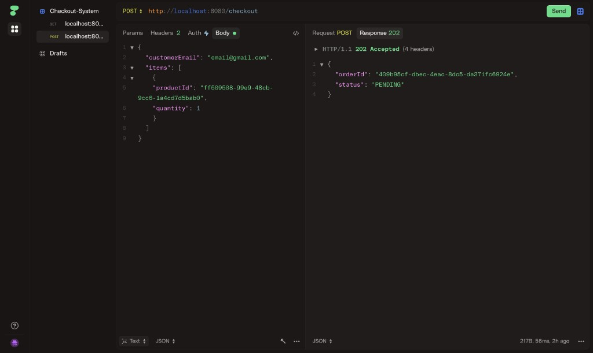

# Checkout System

> **English:** [README.md](README.md)

API de checkout que aceita o pedido rápido (`202`) e processa pagamento e estoque em um **Worker** separado, via RabbitMQ. O Postgres é a fonte da verdade; o Redis garante idempotência no `POST /checkout`.

Sem frontend de propósito — validação com Insomnia/curl, DBeaver e k6.

**Stack:** Node 20, TypeScript, Fastify, Prisma, PostgreSQL, Redis, RabbitMQ, monorepo pnpm.

Arquitetura: **[docs/architecture.md](docs/architecture.md)** (inglês)

Notas por tópico em **[docs/guides/](docs/guides/)** (português).

<p align="center">
  
</p>

## Começar aqui

```bash
cp .env.example .env
docker compose up -d
pnpm install
pnpm build
```

Terminal 1 — API:

```bash
pnpm dev:api
```

Terminal 2 — Worker:

```bash
pnpm dev:worker
```

```bash
curl -s http://localhost:8080/health
```

UUID do produto demo:

```bash
docker compose exec postgres psql -U checkout -d checkout \
  -c "SELECT id, name, stock_quantity FROM products;"
```

Checkout (substitua `productId`):

```bash
curl -s -X POST http://localhost:8080/checkout \
  -H "Content-Type: application/json" \
  -H "X-Idempotency-Key: test-$(uuidgen)" \
  -d '{"customerEmail":"you@example.com","items":[{"productId":"<uuid>","quantity":1}]}'
```

Status do pedido:

```bash
curl -s http://localhost:8080/orders/<orderId>
```

## Portas no host

| Serviço | Porta |
|---------|-------|
| API | 8080 |
| Postgres | 8081 |
| Redis | 8082 |
| RabbitMQ (AMQP) | 8083 |
| RabbitMQ UI | 8084 (`checkout` / `checkout_secret`) |

O Worker não expõe HTTP — só consome a fila.

## Estrutura

```text
apps/api          # HTTP — POST /checkout, GET /orders/:id
apps/worker       # consumer — pagamento simulado, estoque, ACK/DLQ
packages/contracts
packages/database
packages/messaging
scripts/db        # SQL manual antes do Prisma
scripts/k6
docs/
  guides/         # notas por tópico (português)
```

## Teste de carga (k6)

Requer `brew install k6`, API + Worker no ar e estoque suficiente. Detalhes em **[docs/guides/load-testing-k6.md](docs/guides/load-testing-k6.md)**.

```bash
K6_SMOKE=1 pnpm k6:checkout   # 15s, 3 VUs
pnpm k6:checkout              # rampa até 15 VUs
```

Em um run local típico: ~9,5k requests, **p95 ~22 ms** na API, **0%** de falha HTTP; muitos `PENDING` no Postgres após carga forte com `prefetch=1` no Worker é esperado (backlog assíncrono).

## Destaques

- Idempotência (`X-Idempotency-Key` + Redis)
- Schema Postgres na mão + Prisma
- ACK manual, requeue e DLQ
- Estoque com decremento atômico no Worker
- Gateway fake, retry/backoff e circuit breaker
- `orders.failure_reason` quando o checkout falha

## Capturas

**[docs/assets/](docs/assets/)** — Insomnia (202), DBeaver (backlog k6), resumos k6 smoke + ramp, filas RabbitMQ + DLQ.

## Documentação

| | |
|--|--|
| [architecture.md](docs/architecture.md) | visão geral (EN) |
| [idempotency.md](docs/guides/idempotency.md) | idempotência Redis |
| [database-schema.md](docs/guides/database-schema.md) | SQL + Prisma |
| [worker.md](docs/guides/worker.md) | consumer RabbitMQ |
| [inventory.md](docs/guides/inventory.md) | `order_items`, concorrência |
| [payment-gateway.md](docs/guides/payment-gateway.md) | pagamento simulado |
| [load-testing-k6.md](docs/guides/load-testing-k6.md) | carga na API |

SQL: `pnpm db:schema`, `pnpm db:order-items`, `pnpm db:order-failure-reason`, `pnpm db:generate`.

## Testes

Validação manual (Insomnia/curl, DBeaver, UI do RabbitMQ) e k6. Sem suíte unit/e2e automatizada — o foco é o fluxo integrado.

## Infra

```bash
./scripts/smoke-infra.sh   # depois do compose up
docker compose down        # parar
docker compose down -v     # parar e apagar volumes deste projeto
```
